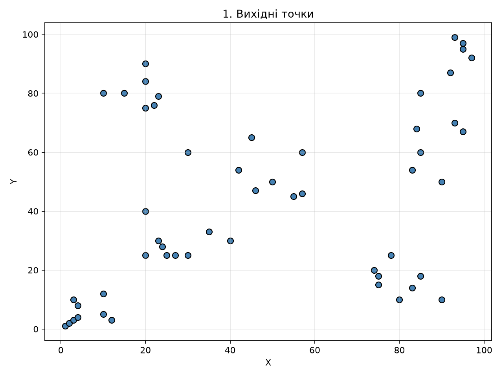
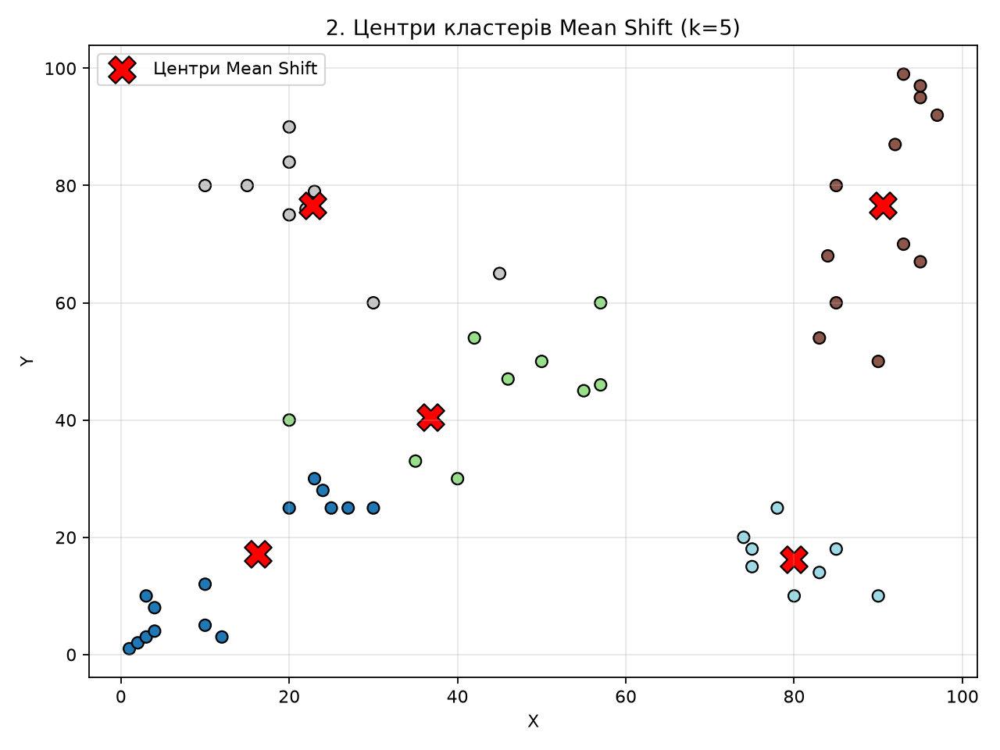
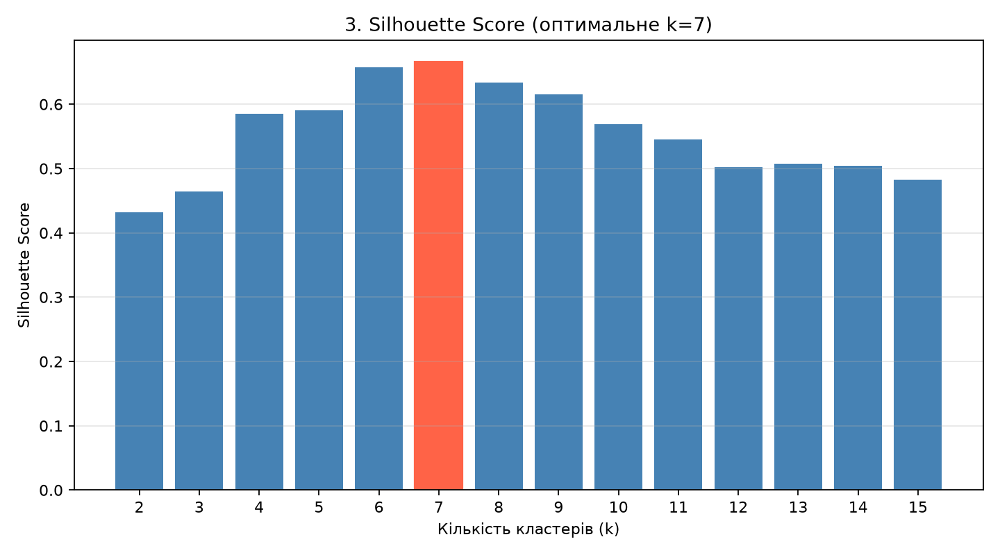
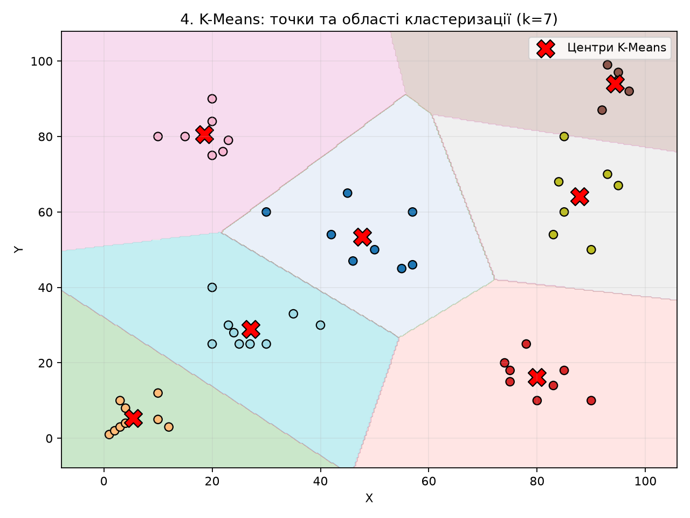

# Лабораторна робота №1
## Кластеризація даних методами Mean Shift та K-Means

### Мета роботи
Дослідити методи кластеризації даних, визначити кількість кластерів методом Mean Shift та знайти оптимальну кількість кластерів K-Means за допомогою Silhouette Score.

### Виконані завдання
1. Завантаження даних із файлу `lab01.csv`.
2. Кластеризація методом Mean Shift.
3. Обчислення Silhouette Score для кількості кластерів від 2 до 15.
4. Визначення оптимальної кількості кластерів.
5. Кластеризація методом K-Means.
6. Побудова чотирьох графіків.

### Результати
- Mean Shift: 5 кластерів.
- Оптимальна кількість кластерів K-Means: 7.
- Максимальний Silhouette Score: 0.6661.

### Запуск програми

Встановити необхідні бібліотеки:

```bash
pip install numpy pandas matplotlib scikit-learn
```

Запустити програму:

```bash
python lab01_solution.py
```

### Графіки

**1. Вихідні точки**



**2. Центри кластерів Mean Shift**



**3. Діаграма Silhouette Score**



**4. Кластеризація K-Means**



### Висновок
У ході лабораторної роботи було реалізовано кластеризацію даних методами Mean Shift та K-Means. Метод Mean Shift визначив 5 кластерів. За результатами аналізу Silhouette Score оптимальною серед перевірених виявилася кількість 7 кластерів для K-Means.
